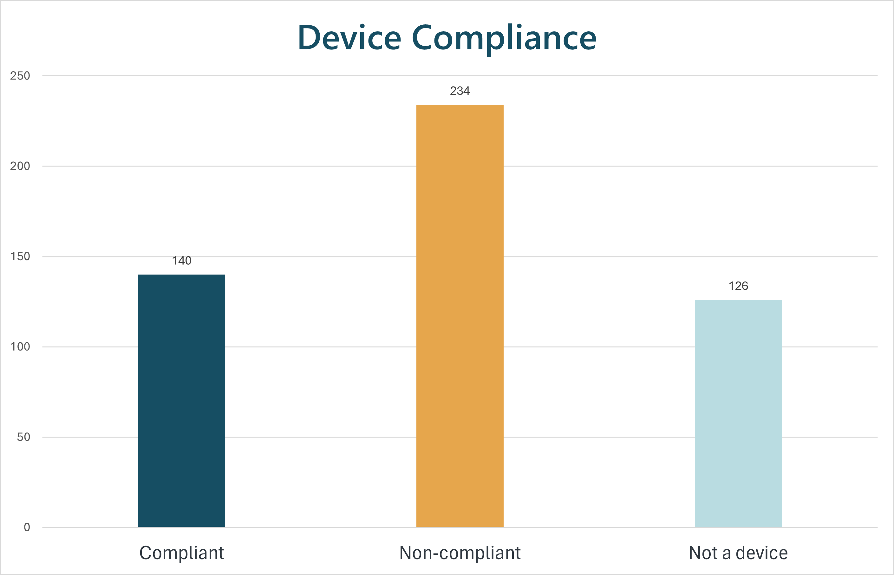
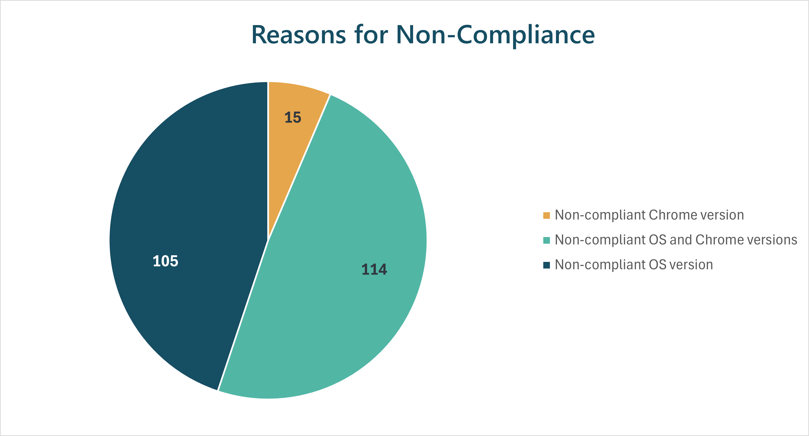

# Excel Report

This report approaches these following points:
1. Device compliance
2. Battery and device health
3. Disk usage

## 1. Device Compliance
Two conditions were required for a device to be compliant:
1. Its OS version had to be compliant.
2. Its Chrome version had to be compliant.

The following columns were used to determine whether a device was compliant:

- **OS_Version**: Specifies the device's operating system version.
- **Chrome_Version**: Specifies the device's Chrome version.
- **OS_Compliance**: Uses `XLOOKUP()` to check the device's OS version against the OS compliance table and returns either `TRUE` or `FALSE`.
- **Chrome_Compliance**: Uses `IFERROR()`, `NUMBERVALUE()`, and `TEXTBEFORE()` to determine whether the device's Chrome version meets the minimum required version of `140.0.0.0`.
- **Compliance**: Returns `TRUE` if both `OS_Compliance` and `Chrome_Compliance` are `TRUE`; otherwise, it returns `FALSE`.
- **Reason**: Uses `IF()` statements to identify whether a device is non-compliant due to its OS version, Chrome version, or both.

### OS Version Compliance
The OS versions were extracted into a new table using Excel's `UNIQUE()` function. A second column was then added, in which each OS version was manually assigned a `TRUE` or `FALSE` value depending on whether it was considered compliant.

### Chrome Version Compliance
Any Chrome version older than 140.0.0.0 was considered non-compliant. The `IF()` and `TEXTSPLIT()` functions were used to evaluate each Chrome version against this requirement, returning `TRUE` if the version was compliant and `FALSE` otherwise.

### Results

Using a PivotTable, the devices were sorted into three categories: *Compliant*, *Non-compliant* or *Not a device*. The chart generated from it shows that there are 234 non-compliant devices, 140 compliant devices and 126 elements that are not devices.

To identify why the 234 devices are non-compliant, another PivotTable was created. This time, it counts the occurrences of each entry in the *Reason* column of the data table.

Among the 234 non-compliant devices, 15 have a non-compliant Chrome version, 105 have a non-compliant OS version, and the remaining devices have both non-compliant OS and Chrome versions.

